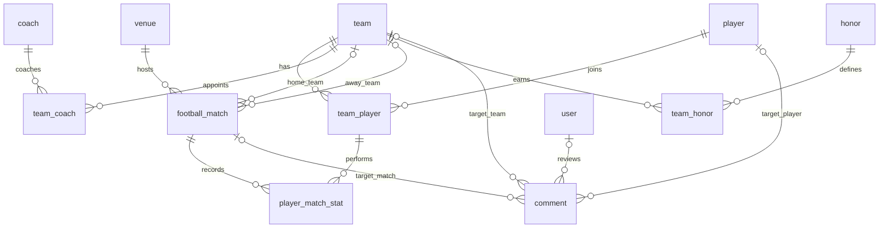

# 数据字典与ER关系

本稿为设计起点，不是最终已实施数据库。建议12张表，匹配需求与三人分工；无需增加新闻等范围外模块。

## 表记录数

| 表 | 行数 | 说明 |
| --- | ---: | --- |
| `user` | 0 | 项目初始化创建；不属于公开赛事资料 |
| `team` | 6 | 精选样本，详见来源 |
| `player` | 24 | 精选样本，详见来源 |
| `team_player` | 24 | 精选样本，详见来源 |
| `coach` | 6 | 精选样本，详见来源 |
| `team_coach` | 6 | 精选样本，详见来源 |
| `venue` | 5 | 精选样本，详见来源 |
| `football_match` | 8 | 精选样本，详见来源 |
| `player_match_stat` | 24 | 精选样本，详见来源 |
| `honor` | 2 | 精选样本，详见来源 |
| `team_honor` | 14 | 精选样本，详见来源 |
| `comment` | 0 | 项目初始化创建；不属于公开赛事资料 |

## 字段定义

主键均为自增整数；ID仅是本包内部标识，只有fifa_match_number是FIFA比赛编号。source_ids是分号分隔的来源编号，映射JSON中sources；不计为额外业务表。

### user

| 字段 | SQL类型 | 说明 |
| --- | --- | --- |
| `id` | `INT` | 主键 |
| `username` | `VARCHAR(255)` | 管理员账号 |
| `auth_key` | `VARCHAR(32)` | Yii2认证密钥 |
| `password_hash` | `VARCHAR(255)` | Yii2兼容密码散列 |
| `password_reset_token` | `VARCHAR(255)` | 重置令牌，可空 |
| `email` | `VARCHAR(255)` | 管理员邮箱 |
| `status` | `SMALLINT` | Yii2状态 |
| `created_at` | `INT` | Unix时间戳 |
| `updated_at` | `INT` | Unix时间戳 |
| `verification_token` | `VARCHAR(255)` | 邮箱令牌，可空 |
外键：无
唯一约束：username；email；password_reset_token

### team

| 字段 | SQL类型 | 说明 |
| --- | --- | --- |
| `id` | `INT` | 主键 |
| `name_zh` | `VARCHAR(80)` | 中文球队名 |
| `name_en` | `VARCHAR(80)` | 英文球队名 |
| `fifa_code` | `VARCHAR(3)` | FIFA三字码，唯一 |
| `country` | `VARCHAR(80)` | 国家或地区 |
| `continent` | `VARCHAR(30)` | 洲 |
| `introduction` | `TEXT` | 自编精简介绍 |
| `logo_path` | `VARCHAR(500)` | 队徽路径，可空 |
| `source_ids` | `VARCHAR(255)` | 来源编号 |
| `source_page` | `INT` | 官方名单页码 |
外键：无
唯一约束：fifa_code

### player

| 字段 | SQL类型 | 说明 |
| --- | --- | --- |
| `id` | `INT` | 主键 |
| `name_zh` | `VARCHAR(80)` | 中文展示译名 |
| `name_en` | `VARCHAR(100)` | 英文常用名 |
| `nationality` | `VARCHAR(80)` | 国籍 |
| `birth_date` | `DATE` | 出生日期 |
| `photo_path` | `VARCHAR(500)` | 照片路径，可空 |
| `source_ids` | `VARCHAR(255)` | 来源编号 |
| `source_page` | `INT` | 官方名单页码 |
外键：无
唯一约束：除主键外无

### team_player

| 字段 | SQL类型 | 说明 |
| --- | --- | --- |
| `id` | `INT` | 主键 |
| `team_id` | `INT` | 球队外键 |
| `player_id` | `INT` | 球员外键 |
| `tournament_year` | `INT` | 赛事年份2026 |
| `shirt_number` | `INT` | 本届号码1至26 |
| `position_code` | `VARCHAR(2)` | GK/DF/MF/FW |
| `source_ids` | `VARCHAR(255)` | 来源编号 |
外键：`team_id` → `team.id`（RESTRICT）；`player_id` → `player.id`（RESTRICT）
唯一约束：team_id + player_id + tournament_year；team_id + tournament_year + shirt_number

### coach

| 字段 | SQL类型 | 说明 |
| --- | --- | --- |
| `id` | `INT` | 主键 |
| `name_zh` | `VARCHAR(80)` | 中文展示译名 |
| `name_en` | `VARCHAR(100)` | 英文常用名 |
| `nationality` | `VARCHAR(80)` | 国籍 |
| `introduction` | `TEXT` | 自编简介，明确赛事快照 |
| `photo_path` | `VARCHAR(500)` | 照片路径，可空 |
| `source_ids` | `VARCHAR(255)` | 来源编号 |
| `source_page` | `INT` | 官方名单页码 |
外键：无
唯一约束：除主键外无

### team_coach

| 字段 | SQL类型 | 说明 |
| --- | --- | --- |
| `id` | `INT` | 主键 |
| `team_id` | `INT` | 球队外键 |
| `coach_id` | `INT` | 教练外键 |
| `tournament_year` | `INT` | 赛事年份 |
| `role` | `VARCHAR(30)` | head_coach |
| `source_ids` | `VARCHAR(255)` | 来源编号 |
外键：`team_id` → `team.id`（RESTRICT）；`coach_id` → `coach.id`（RESTRICT）
唯一约束：team_id + coach_id + tournament_year

### venue

| 字段 | SQL类型 | 说明 |
| --- | --- | --- |
| `id` | `INT` | 主键 |
| `name_zh` | `VARCHAR(80)` | 中文场地名 |
| `name_en` | `VARCHAR(100)` | FIFA赛事场地名 |
| `city` | `VARCHAR(80)` | 实际城市，可能不同于营销城市名 |
| `country` | `VARCHAR(80)` | 国家 |
| `timezone` | `VARCHAR(50)` | IANA时区 |
| `source_ids` | `VARCHAR(255)` | 来源编号 |
外键：无
唯一约束：除主键外无

### football_match

| 字段 | SQL类型 | 说明 |
| --- | --- | --- |
| `id` | `INT` | 主键 |
| `fifa_match_number` | `INT` | 官方比赛编号，唯一 |
| `tournament_year` | `INT` | 赛事年份 |
| `stage` | `VARCHAR(30)` | 比赛阶段枚举 |
| `venue_id` | `INT` | 场地外键 |
| `home_team_id` | `INT` | 本库球队外键；库外可空 |
| `away_team_id` | `INT` | 本库球队外键；库外可空 |
| `home_team_name` | `VARCHAR(80)` | 主队展示名称快照 |
| `away_team_name` | `VARCHAR(80)` | 客队展示名称快照，含库外对手 |
| `local_match_date` | `DATE` | 当地日期，不直接当北京时间 |
| `kickoff_utc` | `DATETIME` | UTC开球时间；由来源时间及时差换算 |
| `match_date_beijing` | `DATE` | 北京时间日期，网站显示和筛选使用 |
| `status` | `VARCHAR(20)` | not_started/live/finished/postponed/cancelled |
| `home_score` | `INT` | 主队比分；未知为NULL |
| `away_score` | `INT` | 客队比分；未知为NULL |
| `after_extra_time` | `SMALLINT` | 是否含加时：0/1；点球数不混入比分 |
| `source_ids` | `VARCHAR(255)` | 来源编号 |
外键：`venue_id` → `venue.id`（RESTRICT）；`home_team_id` → `team.id`（RESTRICT）；`away_team_id` → `team.id`（RESTRICT）
唯一约束：fifa_match_number

### player_match_stat

| 字段 | SQL类型 | 说明 |
| --- | --- | --- |
| `id` | `INT` | 主键 |
| `match_id` | `INT` | 比赛外键 |
| `team_player_id` | `INT` | 本届阵容外键，由此取得球队与球员 |
| `appeared` | `SMALLINT` | 是否实际出场，0/1 |
| `goals` | `INT` | 本场进球数 |
| `assists` | `INT` | 本场助攻；未核实为NULL，不是0 |
| `source_ids` | `VARCHAR(255)` | 来源编号 |
外键：`match_id` → `football_match.id`（RESTRICT）；`team_player_id` → `team_player.id`（RESTRICT）
唯一约束：match_id + team_player_id

### honor

| 字段 | SQL类型 | 说明 |
| --- | --- | --- |
| `id` | `INT` | 主键 |
| `name` | `VARCHAR(80)` | 荣誉名称 |
| `competition` | `VARCHAR(80)` | 所属赛事 |
| `source_ids` | `VARCHAR(255)` | 来源编号 |
外键：无
唯一约束：除主键外无

### team_honor

| 字段 | SQL类型 | 说明 |
| --- | --- | --- |
| `id` | `INT` | 主键 |
| `team_id` | `INT` | 球队外键 |
| `honor_id` | `INT` | 荣誉外键 |
| `year` | `INT` | 获得年份 |
| `description` | `VARCHAR(255)` | 荣誉说明 |
| `source_ids` | `VARCHAR(255)` | 来源编号 |
外键：`team_id` → `team.id`（RESTRICT）；`honor_id` → `honor.id`（RESTRICT）
唯一约束：team_id + honor_id + year

### comment

| 字段 | SQL类型 | 说明 |
| --- | --- | --- |
| `id` | `INT` | 主键 |
| `team_id` | `INT` | 球队留言目标，可空 |
| `player_id` | `INT` | 球员留言目标，可空 |
| `match_id` | `INT` | 比赛留言目标，可空 |
| `nickname` | `VARCHAR(30)` | 昵称1至30字 |
| `content` | `TEXT` | 正文1至1000字 |
| `status` | `VARCHAR(20)` | pending/approved/rejected/deleted |
| `created_at` | `DATETIME` | 创建时间 |
| `reviewed_by` | `INT` | 审核管理员外键，可空 |
| `reviewed_at` | `DATETIME` | 审核时间，可空 |
外键：`team_id` → `team.id`（RESTRICT）；`player_id` → `player.id`（RESTRICT）；`match_id` → `football_match.id`（RESTRICT）；`reviewed_by` → `user.id`（RESTRICT）
唯一约束：除主键外无

## ER图

ER图源文件也单独提供为“07_ER图.mmd”。适合粘贴到支持Mermaid的Markdown或ER图工具，再补字段和布局。

图中的可选球队关系用于库外对手；留言三种对象是“恰好选一”，不是同时三选。图不能表达的条件由应用规则约束。

## 必须同步到Yii2校验的规则

1. 比赛至少有一侧关联本库球队；两侧皆为库内时不得相同。库外一侧ID为空但名称必填；库内名称由球队资料写入，避免与ID矛盾。
2. 比赛、阵容和球员统计属于同一赛事年份；统计球员所属球队必须等于该场主队或客队ID。
3. 比分非负，finished状态计入统计前必须双方比分完整；未知为NULL。状态及阶段使用枚举白名单，不接收随意字符串。
4. 单场球员进球为非负数且不超过其球队该场比分；未出场球员不得记正数进球。同一场与阵容关系唯一。
5. 阵容位置仅GK、DF、MF、FW；每队每届球衣号码唯一。出生日期必须为有效日期。
6. 每条留言的team_id、player_id、match_id必须恰有一个非空，且对象真实存在。昵称1—30字，正文1—1000字，审核状态白名单；reviewed_by必须引用管理员。
7. 所有后台接口检查管理员身份。密码用Yii2散列。留言安全转义，上传校验文件类型与大小。
8. 使用FK RESTRICT阻止直接删除有历史关联的数据；在界面给出依赖提示。上传图片不存在时显示占位图。
9. MySQL 5.7不会可靠执行CHECK约束，因此本准备SQL不靠CHECK保证上述跨表规则，必须写入模型校验或服务事务。

## 与分工中的简化方案差异

- player_match_stat使用team_player_id关联本届阵容，从关系取得球员及球队，避免重复保存player_id和team_id发生矛盾。
- comment采用三个可空目标外键，不用无法直接建立外键的多态target_id；恰好选一由程序校验。
- 比赛增加UTC、当地日期及北京时间日期，解决跨日；用户页面仍只需显示北京时间日期。
- 库外球队只存名称，满足当前需求，不强制补录为重点球队。
- 这些是便于导入与画ER图的建议，三人确认后再同步至正式设计文档及代码。
