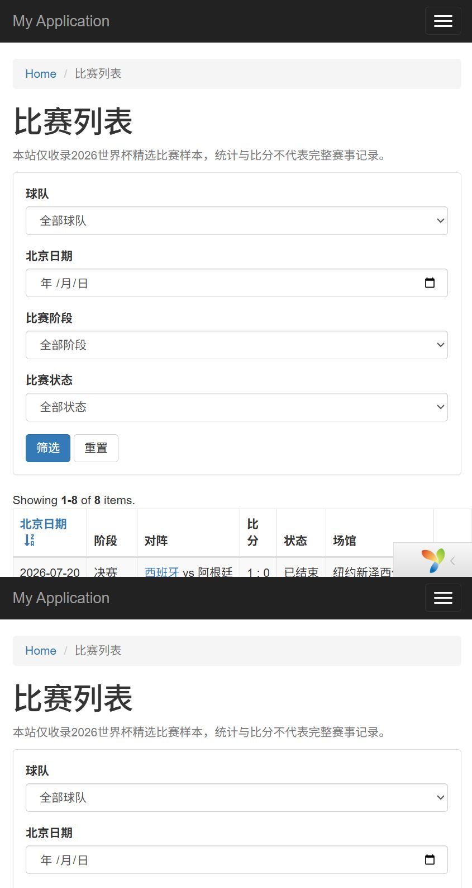
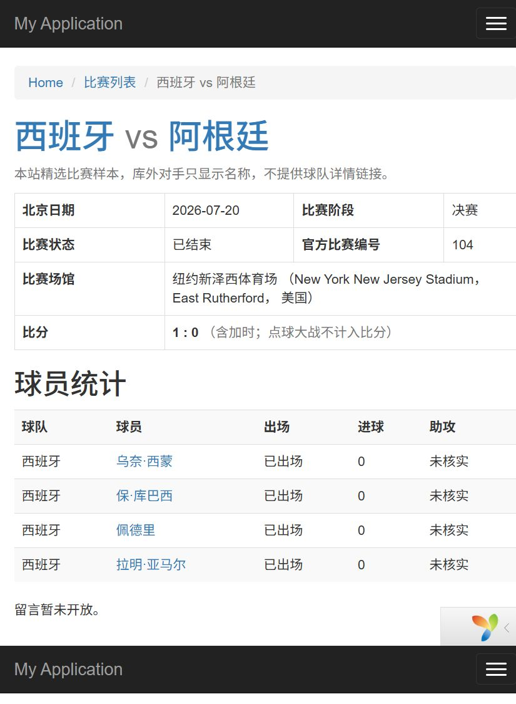
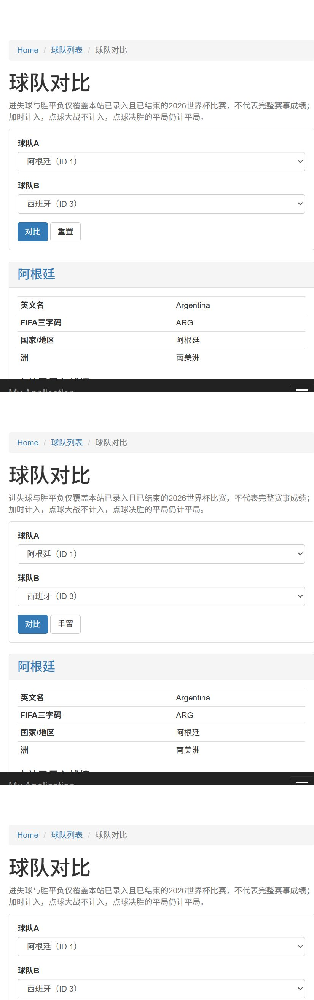
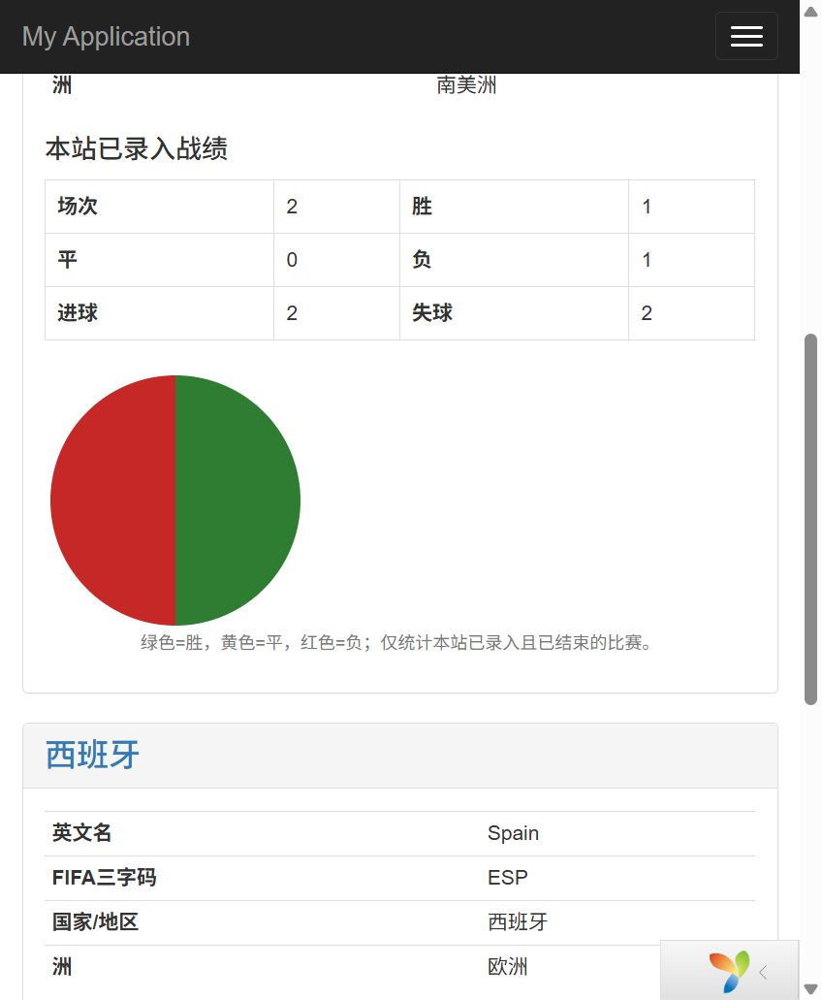
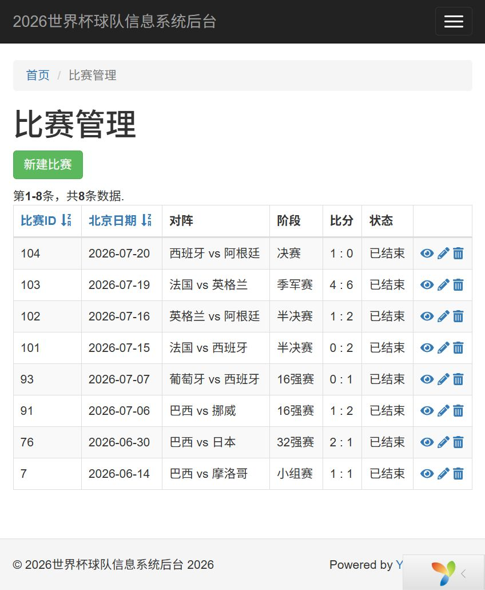

# 2026 世界杯球队信息系统 用户手册

| 项目 | 内容 |
| --- | --- |
| 系统名称 | 2026 世界杯球队信息系统（Yii2 advanced） |
| 文档版本 | v1.0 |
| 编写 | 邓佳怡（学号 2412612） |
| 编写日期 | 2026-11-25 |
| 适用范围 | 本仓库 `data/team/advanced` 当前版本；访客与管理员操作 |
| 配套文档 | 《部署文档》《实现文档》《设计文档》 |

本手册按“访客 → 管理员 → 统计口径 → 错误提示”的顺序说明操作步骤。文中地址以本机默认端口为例：前台 `http://127.0.0.1:8080`，后台 `http://127.0.0.1:8081`。项目未启用 URL 美化，页面地址均为 `index.php?r=控制器/动作` 形式。

---

## 1. 系统简介

本系统面向 2026 世界杯，提供球队、球员、教练、荣誉、比赛、场馆和球员单场统计的浏览与后台维护，并提供两队资料对比与胜平负饼图。

需要注意的数据边界：

1. 本站只收录**精选样本**，不是完整赛事数据库；页面中的场次、胜平负、进失球都只统计“本站已录入且已结束”的比赛。
2. 比赛可以只关联一侧本库球队，另一侧为“库外对手”，库外对手只显示名称，不提供球队详情链接。
3. 球员统计中“助攻”留空表示**未核实**，不代表 0 次助攻；未录入统计也不代表球员未出场或 0 进球。

---

## 2. 启动与访问

在项目根目录 `data/team/advanced` 下打开 PowerShell：

```powershell
# 前台
D:\xampp\php\php.exe -d extension=intl -d session.save_path=frontend\runtime\sessions -d sys_temp_dir=frontend\runtime -S 127.0.0.1:8080 -t frontend\web

# 后台（另开一个窗口）
D:\xampp\php\php.exe -d extension=intl -d session.save_path=backend\runtime\sessions -d sys_temp_dir=backend\runtime -S 127.0.0.1:8081 -t backend\web
```

| 入口 | 地址 |
| --- | --- |
| 前台首页 | `http://127.0.0.1:8080/index.php?r=site/index` |
| 比赛列表 | `http://127.0.0.1:8080/index.php?r=football-match/index` |
| 球队列表 | `http://127.0.0.1:8080/index.php?r=team/index` |
| 球队对比 | `http://127.0.0.1:8080/index.php?r=team/compare` |
| 后台登录 | `http://127.0.0.1:8081/index.php?r=site/login` |

若 PHP 已启用 `intl`，可省略 `-d extension=intl`。完整环境准备见《部署文档》。

---

## 3. 访客操作

### 3.1 首页与导航

打开前台首页后，顶部导航提供“比赛列表”“球队对比”等入口；面包屑可返回上一级。页面底部为课程作业仓库入口（由组长统一维护）。

### 3.2 浏览球队

1. 进入 `球队列表`，点击球队名称打开详情。
2. 球队详情展示中文名、英文名、FIFA 三字码、国家/地区、洲、简介，以及本届阵容、教练组、荣誉等关联信息。
3. 若球队没有 logo，页面不显示破损图片；简介为空时显示占位文字。

### 3.3 浏览球员与教练

- 球员详情：`index.php?r=player/view&id=球员ID`，展示姓名、国籍、生日、照片（如有）及所属阵容记录。
- 教练详情：`index.php?r=coach/view&id=教练ID`，展示姓名、国籍、简介及执教球队。
- 生日为空时显示“—”，不会显示 `0000-00-00`。

### 3.4 比赛列表与筛选

进入“比赛列表”后可按以下条件筛选，点击“筛选”提交，点击“重置”清空：

| 筛选项 | 说明 |
| --- | --- |
| 球队 | 选择本库球队，显示该队作为主队或客队的比赛 |
| 日期 | 按北京日期精确匹配 |
| 阶段 | 小组赛、1/16 决赛、1/8 决赛、1/4 决赛、半决赛、三四名决赛、决赛等 |
| 状态 | 未开始、进行中、已结束、延期、取消 |

列表规则：

1. 每页 10 条，按北京日期倒序、同一天按 ID 倒序。
2. 未结束的比赛比分显示“—”，不显示 0:0。
3. 库外对手只显示名称，不生成球队链接。
4. 筛选条件非法（例如日期格式错误、球队 ID 非正整数）时显示错误提示，并返回空结果，不显示全表。
5. 没有匹配数据时显示“没有找到匹配的比赛”。



### 3.5 比赛详情

点击列表中的“详情”进入比赛详情页，页面包含：

- 北京日期、阶段、状态、官方比赛编号（未录入显示“未录入”）；
- 场馆中文名、英文名、城市、国家；未关联场馆显示“未录入”；
- 比分：仅“已结束”显示 `主队 : 客队`；含加时的比赛额外标注“点球大战不计入比分”；
- 球员统计：球队、球员（可点击进入球员详情）、出场情况、进球、助攻。助攻未核实时显示“未核实”。

未录入球员统计时显示“本场暂未录入球员统计；未录入不代表未出场或 0 进球”。



### 3.6 球队对比与饼图

1. 从导航进入“球队对比”。
2. 在“球队A”“球队B”中选择两支不同球队，点击“对比”。
3. 页面并排展示两队基本资料与本站已录入战绩：场次、胜、平、负、进球、失球。
4. 每队下方为胜平负饼图：**绿色 = 胜，黄色 = 平，红色 = 负**。
5. 已选择两队时，直接切换任一下拉框，页面会通过 AJAX 局部刷新对应卡片、饼图与标题，不整页跳转，已输入的页面状态不会丢失。
6. 某队在本站没有已结束比赛时，卡片显示 0 场并提示“暂无已结束比赛”，不绘制空饼图。
7. 数据加载失败时，卡片内出现红色提示和“重试”按钮；连续快速切换时只采用最后一次选择的结果，过期响应会被忽略。





### 3.7 留言

比赛详情页底部提供留言区：

1. 填写昵称（最多 30 字）和留言内容（最多 1000 字），点击“提交留言”。
2. 提交成功后返回比赛详情并提示“留言已提交，审核通过后显示”。
3. 留言默认进入待审核状态，**审核通过前不会公开显示**；公开留言每页 10 条。
4. 昵称或内容为空、超长时，页面保留已填内容并显示具体错误。
5. 留言对象不存在时返回 404；留言功能未配置时显示“留言暂未开放”。

> 说明：留言的审核操作由组长负责的留言审核模块完成；本模块只负责在比赛详情页挂载统一留言组件，不重复实现审核逻辑。

---

## 4. 管理员操作

### 4.1 登录、退出与修改密码

1. 打开后台 `http://127.0.0.1:8081/index.php?r=site/login`。
2. 输入管理员用户名和密码，点击“登录”。
3. 登录后导航显示“比赛管理”下拉与“修改密码”；右上角显示当前账号，点击可退出。
4. 未登录时访问任何后台业务页面都会跳转到登录页。
5. 修改密码需输入当前密码与新密码；修改成功后建议重新登录验证。

管理员账号由部署时的 `php yii admin/init` 创建，本手册不记录任何真实账号或密码。

### 4.2 后台导航

登录后可见：

- 后台首页
- 比赛管理 → 场馆 / 比赛 / 球员统计
- 修改密码

其他基础资料（球队、球员、教练、荣誉等）由组员一负责，入口以最终合并版本为准。

### 4.3 场馆管理

进入“比赛管理 → 场馆”：

1. **新建**：填写中文名（必填）、英文名、城市、国家，点击“创建”。
2. **编辑**：在列表点击“更新”，修改后点击“保存”。
3. **查看**：点击“查看”显示场馆资料及引用它的比赛。
4. **删除**：仅允许删除未被任何比赛引用的场馆。若已被引用，系统提示“该场馆已被比赛引用，不能删除”，需先调整或删除相关比赛。

### 4.4 比赛管理

进入“比赛管理 → 比赛”，列表展示编号、年份、阶段、对阵、比分、状态、场馆等。

新建/编辑表单字段与规则：

| 字段 | 是否必填 | 规则 |
| --- | --- | --- |
| 官方比赛编号 | 否 | 正整数；同一年份内唯一，留空可多条共存 |
| 赛事年份 | 是 | 默认 2026，整数 |
| 阶段 | 是 | 从固定阶段中选择 |
| 场馆 | 否 | 从场馆表选择 |
| 北京日期 | 是 | 日期格式 |
| 主队/客队 | 至少一侧关联 | 至少一侧必须是本库球队，两侧不能相同 |
| 主队名称/客队名称 | 是 | 展示名称，可不同于球队表名称；库外对手只填名称、ID 留空 |
| 状态 | 是 | 未开始/进行中/已结束/延期/取消 |
| 主队比分/客队比分 | 视状态 | 仅“已结束”必须填写两个非负整数；其他状态必须留空 |
| 是否加时 | 否 | 是/否；比分含加时，不含点球大战 |

比分与统计锁定：

1. 一场比赛只要存在任意球员统计，双方球队 ID、双方展示名称、赛事年份、状态和比分都会被锁定，表单中对应控件置灰。
2. 解锁方式只有一种：先到“球员统计”中删除该场全部统计，再返回修改比赛。
3. 删除比赛前，系统检查球员统计和留言引用；存在引用时拒绝删除并提示原因。



### 4.5 球员统计管理

进入“比赛管理 → 球员统计”：

1. **新建**：选择比赛、选择该场对应球队的本届阵容记录、选择是否出场，填写进球与助攻，点击“创建”。
2. **编辑**：点击“更新”修改出场、进球、助攻。
3. **删除**：确认后删除；删除最后一条统计后，对应比赛自动解除锁定。
4. **查看**：显示统计详情及关联比赛、球员、球队。

校验规则：

| 场景 | 结果 |
| --- | --- |
| 比赛不是“已结束” | 拒绝保存，提示仅已结束比赛可录入统计 |
| 阵容年份与比赛年份不一致 | 拒绝保存 |
| 阵容所属球队不是本场主队或客队 | 拒绝保存 |
| 进球数大于本队本场比分 | 拒绝保存 |
| 标记为未出场但进球不为 0 | 拒绝保存 |
| 未出场且填写了助攻 | 拒绝保存（已知助攻必须为 0） |
| 助攻留空 | 允许，表示未核实，页面显示“未核实” |
| 同一比赛重复录入同一阵容球员 | 拒绝保存（唯一约束） |

---

## 5. 统计口径

1. **场次**：只统计状态为“已结束”且双方比分均非空的比赛；主队、客队各计 1 场，一场比赛不会因球员统计行数而重复计数。
2. **胜/平/负**：按本队在该场的进球与失球比较；点球决胜的比赛按加时结束后的比分计为平局，点球大战比分不计入。
3. **进球/失球**：累加本队在已结束比赛中的进球与失球。
4. **库外对手**：只要比赛的一侧关联了本库球队，该场就计入这支本库球队的统计；库外对手没有详情页，也不出现在对比下拉中。
5. **一致性**：`场次 = 胜 + 平 + 负`，服务端会按胜平负重算场次，避免脏数据造成不一致。
6. **覆盖范围**：统计仅覆盖本站已录入的 2026 世界杯已结束比赛，不代表完整赛事成绩。

前台统计接口（供联调与验收使用）：

```text
GET /index.php?r=team/stats&team_id=1
```

- 成功：HTTP 200，`{"success":true,"data":{"team_id":1,"tournament_year":2026,"played":3,"wins":2,"draws":1,"losses":0,"goals_for":5,"goals_against":2},"message":"统计仅覆盖本站已录入的2026世界杯已结束比赛"}`
- 参数非法：HTTP 400
- 球队不存在：HTTP 404
- 服务异常：HTTP 500，不返回 SQL 或堆栈

对比下拉切换时，页面调用的就是该接口。

---

## 6. 错误与提示对照

| 现象 | HTTP | 原因与处理 |
| --- | --- | --- |
| 页面不存在 | 404 | 详情 ID 缺失、非正整数或记录不存在；返回列表重新选择 |
| 请求参数错误 | 400 | 统计接口 `team_id` 非正整数；检查链接参数 |
| 表单校验失败 | 422 | 页面保留输入并显示具体字段错误，按提示修改后重试 |
| 留言暂未开放 | 503 | 该留言目标尚未配置；由对应模块负责人完成接入 |
| 服务器错误 | 500 | 数据库连接或服务异常；查看 `frontend/runtime/logs`、`backend/runtime/logs` 并联系部署负责人 |
| 后台反复跳登录 | 302 | 会话目录不可写或未登录；检查启动参数 `session.save_path` |
| 筛选后无数据 | 200 | 条件过严；点击“重置”恢复全部比赛 |

---

## 7. 截图索引

| 文件 | 内容 |
| --- | --- |
| `截图/match_list.jpg` | 前台比赛列表与筛选 |
| `截图/match_detail.jpg` | 比赛详情、比分与球员统计 |
| `截图/compare_page_initial.jpg` | 球队对比初始页与两队卡片 |
| `截图/pie_charts_visible.jpg` | 胜平负饼图渲染 |
| `截图/ajax_team_switch.jpg` | 切换球队后的局部刷新 |
| `截图/team_compare_verify.jpg` | 对比页复核 |
| `截图/football-match-management.jpg` | 后台比赛管理列表 |

---

## 8. 已知限制

1. 本站为课程作业样本库，比赛、球员统计和荣誉均为精选数据，不能作为完整赛事资料引用。
2. 留言需要后台审核后才公开；审核入口由组长模块提供。
3. 球队/球员/教练等基础资料页面的最终样式与导航以合并后的版本为准。
4. 对比页饼图使用原生 Canvas 绘制，不依赖第三方图表库；极旧浏览器（不支持 Canvas）无法显示图形，但文字数据仍可阅读。
