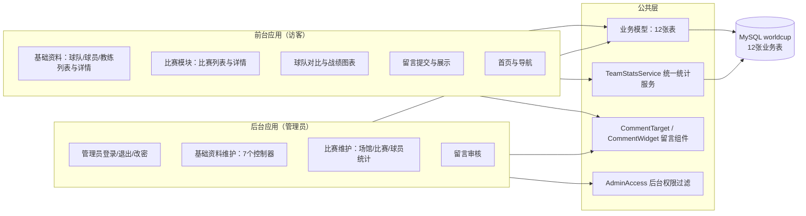
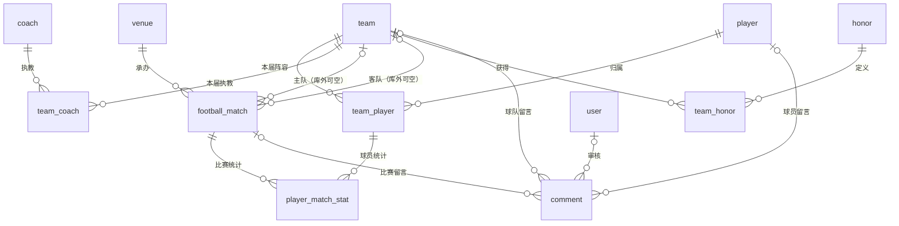
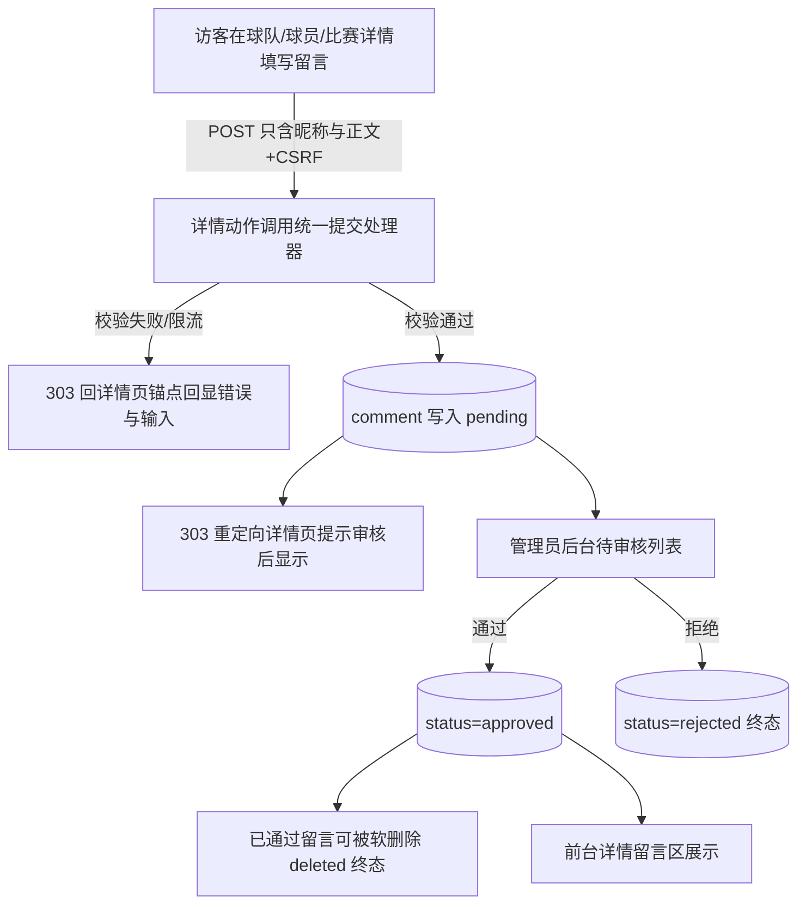
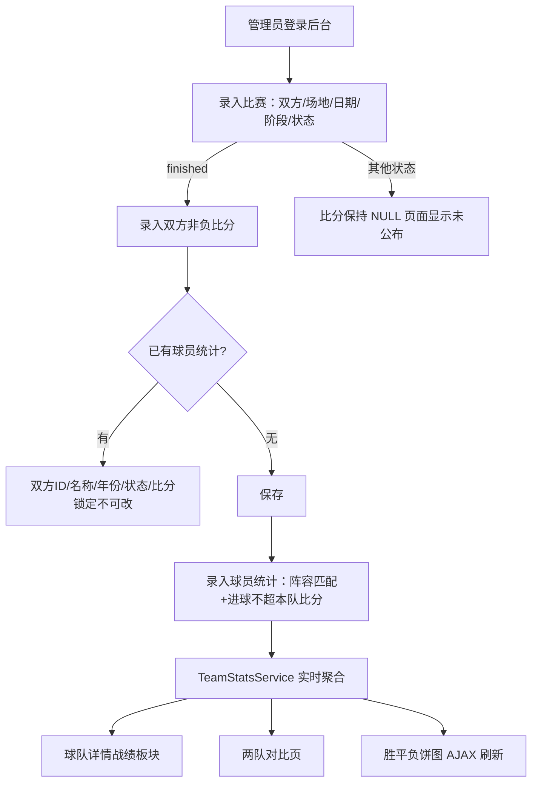
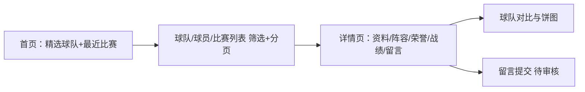

# 设计文档

> 项目：2026世界杯球队信息系统  
> 主笔与汇总：王乐妍（2413423，基础资料模块与数据库统筹）  
> 模块材料提供：认证、留言与导航（牛雨萱 2411061）；比赛、统计与部署（邓佳怡 2412612）  
> 依据：《需求文档.md》、《数据库设计暂定基线.md》、《跨模块接口约定.md》及实际实现代码

## 1. 引言

本文档给出系统的总体架构、数据库结构、模块设计、关键业务流程、接口约定与安全设计，是编码与验收的设计依据。数据字典以《数据库设计暂定基线.md》为准整理；接口细节以《跨模块接口约定.md》为准整理；本文与其内容一致，如后续变更以本文最新版本为设计口径并同步修改依据文档。

系统基于 Yii2 Advanced 模板，前台（frontend）面向访客，后台（backend）面向管理员，公共模型与服务（common）由三模块共享。

## 2. 总体架构与模块设计

| 模块 | 负责人 | 范围 |
| --- | --- | --- |
| 基础资料 | B 王乐妍 | 球队、球员、阵容、教练、执教、荣誉及球队荣誉的模型、前后台 CRUD、详情页挂载 |
| 比赛与统计 | C 邓佳怡 | 场馆、比赛、球员统计模型，统一统计服务，对比页与图表，比赛后台维护，初始化脚本 |
| 认证与留言 | A 牛雨萱 | 管理员认证、后台权限、留言提交与审核、首页导航与仓库入口 |

## 3. 数据库设计

### 3.1 设计原则

1. 共 12 张表：`user` 复用 Yii2 Advanced 自带迁移（承载唯一管理员），业务表 11 张，满足课程“超过10张”要求；`migration` 为框架辅助表，不凑业务表数量。
2. 业务表采用 InnoDB、utf8mb4；主键与外键为有符号 INT 且自增；所有外键 `ON DELETE RESTRICT / ON UPDATE RESTRICT`，阻止静默级联删除。
3. 业务资料录入即公开，不设草稿/发布状态；唯一例外是留言，只有 `approved` 状态对外可见。
4. 未知信息存 NULL 而非空串或 0：队徽/照片/简介可空，球员出生日期可空（未知不显示年龄），比赛未结束时比分为 NULL（显示“未公布”而非 0:0）。
5. 来源信息只保存在资料说明文档，不在业务表存储来源字段。
6. 比赛日期统一北京时间 DATE，不存多时区字段；比分含加时、不含点球大战。
7. 跨表一致性（如“至少一侧为库内球队”“进球不超本队比分”）不能只靠外键/行内 CHECK，由模型校验与事务保证。

### 3.2 ER 图

完整 Mermaid 源码见同目录《数据库ER图.mmd》，核心关系如下：

说明：球队与比赛的连线为可选关系（库外对手只存名称快照，`home_team_id`/`away_team_id` 可空）；留言的三个目标外键在应用层约束“恰好一个非空”。

### 3.3 全库数据字典

主键与关联字段为有符号 INT；必填字符串经 trim 后不得为空；NULL 表示未知或未提供。固定默认值：阵容与执教 `tournament_year` 默认 2026、执教 `role` 默认 head_coach、留言 `status` 默认 pending、比赛 `after_extra_time` 默认 0、管理员 `status` 默认 10；其余必填字段无默认值，由调用方显式赋值。逐表完整可空性与默认值以《数据库设计暂定基线.md》为最终口径。

#### user（复用 Yii2 迁移，不修改结构）

| 字段 | SQL类型 | 可空 | 说明 |
| --- | --- | --- | --- |
| `id` | INT | 否 | 主键，自增 |
| `username` | VARCHAR(255) | 否 | 管理员账号，唯一 |
| `auth_key` | VARCHAR(32) | 否 | Yii2 认证密钥 |
| `password_hash` | VARCHAR(255) | 否 | 安全散列 |
| `password_reset_token` | VARCHAR(255) | 是 | 重置令牌，唯一 |
| `email` | VARCHAR(255) | 否 | 邮箱，唯一 |
| `status` | SMALLINT | 否 | Yii2 状态，默认 10 |
| `created_at` / `updated_at` | INT | 否 | Unix 时间戳 |
| `verification_token` | VARCHAR(255) | 是 | 邮箱令牌 |

#### team（球队）

| 字段 | SQL类型 | 可空 | 说明 |
| --- | --- | --- | --- |
| `id` | INT | 否 | 主键 |
| `name_zh` | VARCHAR(80) | 否 | 中文球队名 |
| `name_en` | VARCHAR(80) | 否 | 英文球队名 |
| `fifa_code` | VARCHAR(3) | 否 | FIFA 三字码，唯一，3 个字母 |
| `country` | VARCHAR(80) | 否 | 国家或地区 |
| `continent` | VARCHAR(30) | 否 | 洲 |
| `introduction` | TEXT | 是 | 球队简介 |
| `logo_path` | VARCHAR(500) | 是 | 队徽路径，缺省显示占位图 |

#### player（球员）

| 字段 | SQL类型 | 可空 | 说明 |
| --- | --- | --- | --- |
| `id` | INT | 否 | 主键 |
| `name_zh` | VARCHAR(80) | 否 | 中文译名 |
| `name_en` | VARCHAR(100) | 否 | 英文常用名 |
| `nationality` | VARCHAR(80) | 否 | 国籍 |
| `birth_date` | DATE | 是 | 出生日期，未知不显示年龄 |
| `photo_path` | VARCHAR(500) | 是 | 照片路径 |

#### team_player（本届阵容）

| 字段 | SQL类型 | 可空 | 说明 |
| --- | --- | --- | --- |
| `id` | INT | 否 | 主键 |
| `team_id` / `player_id` | INT | 否 | 外键 → team / player |
| `tournament_year` | INT | 否 | 赛事年份，默认 2026 |
| `shirt_number` | INT | 否 | 号码 1—26 |
| `position_code` | VARCHAR(2) | 否 | GK/DF/MF/FW |

唯一约束：`(player_id, tournament_year)` 同届仅归属一队；`(team_id, tournament_year, shirt_number)` 同队同届号码唯一。

#### coach（教练）

| 字段 | SQL类型 | 可空 | 说明 |
| --- | --- | --- | --- |
| `id` | INT | 否 | 主键 |
| `name_zh` / `name_en` | VARCHAR(80/100) | 否 | 中英文名 |
| `nationality` | VARCHAR(80) | 否 | 国籍 |
| `introduction` | TEXT | 是 | 简介 |
| `photo_path` | VARCHAR(500) | 是 | 照片路径 |

#### team_coach（执教关系）

| 字段 | SQL类型 | 可空 | 说明 |
| --- | --- | --- | --- |
| `id` | INT | 否 | 主键 |
| `team_id` / `coach_id` | INT | 否 | 外键 → team / coach |
| `tournament_year` | INT | 否 | 赛事年份，默认 2026 |
| `role` | VARCHAR(30) | 否 | 固定 head_coach |

唯一约束：`(team_id, tournament_year)` 同队同届仅一名主教练。

#### venue（比赛场地）

| 字段 | SQL类型 | 可空 | 说明 |
| --- | --- | --- | --- |
| `id` | INT | 否 | 主键 |
| `name_zh` | VARCHAR(80) | 否 | 中文场地名 |
| `name_en` | VARCHAR(100) | 否 | FIFA 赛事场地名 |
| `city` | VARCHAR(80) | 否 | 实际城市 |
| `country` | VARCHAR(80) | 否 | 国家 |

#### football_match（比赛）

| 字段 | SQL类型 | 可空 | 说明 |
| --- | --- | --- | --- |
| `id` | INT | 否 | 主键 |
| `fifa_match_number` | INT | 是 | 官方编号，填写后与年份组合唯一，NULL 表示未知 |
| `tournament_year` | INT | 否 | 赛事年份，默认 2026 |
| `stage` | VARCHAR(30) | 否 | 阶段枚举：group/round_of_32/round_of_16/quarter_final/semi_final/third_place/final |
| `venue_id` | INT | 否 | 外键 → venue |
| `home_team_id` / `away_team_id` | INT | 是 | 外键 → team；库外对手为 NULL，至少一侧非空且两侧不得相同 |
| `home_team_name` / `away_team_name` | VARCHAR(80) | 否 | 展示名称快照（含库外对手） |
| `match_date_beijing` | DATE | 否 | 北京时间日期 |
| `status` | VARCHAR(20) | 否 | not_started/live/finished/postponed/cancelled |
| `home_score` / `away_score` | INT | 是 | finished 时非负且必填；其他状态必须 NULL |
| `after_extra_time` | SMALLINT | 否 | 是否含加时 0/1，点球数不混入比分 |

#### player_match_stat（球员比赛统计）

| 字段 | SQL类型 | 可空 | 说明 |
| --- | --- | --- | --- |
| `id` | INT | 否 | 主键 |
| `match_id` | INT | 否 | 外键 → football_match |
| `team_player_id` | INT | 否 | 外键 → team_player，经其取得球队与球员 |
| `appeared` | SMALLINT | 否 | 0 未出场 / 1 已出场，仅录已核实数据 |
| `goals` | INT | 否 | 非负进球数，不以默认 0 替代未知 |
| `assists` | INT | 是 | 未核实为 NULL，不是 0 |

唯一约束：`(match_id, team_player_id)` 同场同球员仅一条统计。

#### honor（荣誉定义）

| 字段 | SQL类型 | 可空 | 说明 |
| --- | --- | --- | --- |
| `id` | INT | 否 | 主键 |
| `name` | VARCHAR(80) | 否 | 荣誉名称 |
| `competition` | VARCHAR(80) | 否 | 所属赛事 |

#### team_honor（球队荣誉记录）

| 字段 | SQL类型 | 可空 | 说明 |
| --- | --- | --- | --- |
| `id` | INT | 否 | 主键 |
| `team_id` / `honor_id` | INT | 否 | 外键 → team / honor |
| `year` | INT | 否 | 获得年份，正整数 |
| `description` | VARCHAR(255) | 否 | 荣誉说明 |

唯一约束：`(team_id, honor_id, year)`。

#### comment（留言）

| 字段 | SQL类型 | 可空 | 说明 |
| --- | --- | --- | --- |
| `id` | INT | 否 | 主键 |
| `team_id` / `player_id` / `match_id` | INT | 是 | 留言目标外键，应用层约束恰好一个非空 |
| `nickname` | VARCHAR(30) | 否 | 昵称 1—30 字 |
| `content` | TEXT | 否 | 正文 1—1000 字 |
| `status` | VARCHAR(20) | 否 | pending/approved/rejected/deleted |
| `created_at` | DATETIME | 否 | 创建时间 |
| `reviewed_by` | INT | 是 | 审核管理员外键 → user |
| `reviewed_at` | DATETIME | 是 | 审核时间 |

### 3.4 索引与外键

| 表 | 主键以外的唯一键 | 其他索引 |
| --- | --- | --- |
| user | username、email、password_reset_token | 保持现状 |
| team | fifa_code | name_zh（普通索引） |
| player | 无 | name_zh |
| team_player | (player_id,tournament_year)；(team_id,tournament_year,shirt_number) | 唯一键已覆盖外键前缀 |
| coach | 无 | name_zh |
| team_coach | (team_id,tournament_year) | coach_id |
| venue | 无 | 无额外业务索引 |
| football_match | (tournament_year,fifa_match_number) | venue_id；(home_team_id,tournament_year,status)；(away_team_id,tournament_year,status)；match_date_beijing |
| player_match_stat | (match_id,team_player_id) | team_player_id |
| honor | 无 | 无额外业务索引 |
| team_honor | (team_id,honor_id,year) | honor_id |
| comment | 无 | (team_id,status,created_at,id)；(player_id,…)；(match_id,…)；(status,created_at,id)；reviewed_by |

同名球员/教练/场地不加名称唯一约束，不以姓名作主外键；模糊查询不承诺均有索引加速。

## 4. 模块详细设计

### 4.1 基础资料模块（B）

**模型层（B1）**：`common/models/` 下 Team、Player、TeamPlayer、Coach、TeamCoach、Honor、TeamHonor 七个 ActiveRecord，表名使用 `{{%...}}` 前缀约定；关系查询以 ID 关联（`hasMany`），不以姓名代替 ID。核心校验：FIFA 三字码 3 个字母且唯一；号码 1—26；位置枚举 GK/DF/MF/FW。

**前台（B3/B4）**：
- 列表：`/team/index`（GET name 关键词、page，每页 10 条，id 升序）；`/player/index`（GET name、team_id、position，球员按 2026 阵容过滤球队与位置）。
- 详情：`/team/view`、`/player/view`、`/coach/view`；非法或缺失 ID 一律 404；球队详情预加载本届阵容（按号码排序）、主教练与荣誉。
- 展示规则：缺图显示占位块；出生日期未知不显示年龄；所有输出经 `Html::encode` 安全转义；页面注明“精选球员/已收录比赛”。

**球队详情挂载（B7/B8）**：详情页挂载 A 的 `CommentWidget`（targetType=team/player）提交与展示留言；战绩板块调用 C 的 `TeamStatsService::getSummary()` 统一服务（服务异常时降级为提示，不影响资料展示），并提供“查看该队已收录比赛”（携带 `FootballMatchSearch[team_id]` 筛选）与“与其他球队对比”（预选 `team_a_id`）两个入口。

**后台（B5/B6）**：七个控制器继承 `AdminController`，覆盖 behaviors 时保留 parent 过滤器；列表/详情 GET，create/update GET+POST，delete 仅 POST；校验失败保留输入；删除前检查依赖引用，有关联（含被软删除留言引用的目标）拒绝删除并提示依赖，不级联、不静默删除。

### 4.2 比赛与统计模块（C）

**比赛三表与校验**：仅 `finished` 允许完整非负比分，其他状态双方比分必须为 NULL；库外对手一侧 ID 为 NULL 且只显示名称快照；两侧不得为同一球队。`player_match_stat` 只允许关联 finished 比赛，统计阵容年份与球队必须与比赛一致，进球不超本队本场比分；`appeared=0` 时进球与已知助攻必须为 0；同场同球员唯一。

**字段锁定**：比赛存在任意统计行时，双方 ID 与名称、年份、状态、比分锁定，不能修改；解锁只能先删除该场全部统计，修改动作不自动删除统计。

**统一统计服务（C2）**：`common/services/TeamStatsService.php::getSummary($teamId, $year=2026)`，一条聚合 SQL 只取 finished 且比分完整的比赛，不 JOIN 球员统计行避免重复计数；返回固定 8 个整数字段（team_id、tournament_year、played、wins、draws、losses、goals_for、goals_against），满足 played=wins+draws+losses；点球决胜计平局。不存冗余汇总表，查询实时计算。

**对比与图表（C6/C7）**：`/team/compare`（GET team_a_id、team_b_id，同队/非法/不存在显示错误）；`/team/stats` 公开只读 JSON，200/400/404/500 统一结构 `success/data/message`，不泄露 SQL 与堆栈。饼图为浏览器原生 Canvas，无第三方图表库；切换球队走 AJAX 局部刷新，`AbortController` 丢弃过期响应；零场显示空状态不画全零饼图，失败显示重试。

**部署（C8）**：`data/install.sql` 汇总 11 张业务表与样本（不含 user 与管理员，避免覆盖凭据）；`advanced/setup.ps1` 一键初始化，具备环境检查、重复执行保护与失败提示。

### 4.3 认证与留言模块（A）

**权限模型**：前台无访客注册与个人中心；后台唯一启用管理员，所有业务控制器经 `AdminController`/`AdminAccess` 统一过滤，仅 `@` 登录规则不能替代指定管理员校验；SiteController 仅 login/error 公开。

**留言状态机**：`pending → approved / rejected`，`approved / rejected → deleted`；rejected、deleted 为终态，不提供恢复或物理删除。访客表单只提交昵称与正文，目标类型与 ID 由详情控制器固定，状态与审核字段不接受表单赋值。提交失败 303 回原详情页 `#comments` 锚点回显错误与输入（422 语义），成功写入 pending 后 303 重定向防刷新重复提交；同一会话 60 秒限流。后台审核仅 POST 且校验状态流转合法性，服务端记录审核人与北京时间。

**留言目标解析**：`CommentTarget::resolve($type,$id)` 仅接受 team/player/match 三类，按 `frontend/config/params.php` 配置的详情路由与存在性回调校验目标真实存在，配置缺失返回 503，类型非法返回 404。

**作业获取入口**：按需求文档第 12 节最新口径，团队作业与个人作业统一通过前台“关于本站”页的课程作业仓库链接（GitHub，新窗口打开）获取，不在站内建下载控制器、文件列表或上传管理；不设白名单下载模型。此设计替代早期分工方案中的“下载白名单控制器”草案，以需求文档为准。

## 5. 关键业务流程

### 5.1 留言提交与审核

### 5.2 比赛维护与统计更新

### 5.3 访客浏览

## 6. 接口设计摘要

| 页面/接口 | 路由 | 参数与方法 | 排序/说明 |
| --- | --- | --- | --- |
| 球队列表 | /team/index | GET name、page | id ASC，每页 10 条 |
| 球员列表 | /player/index | GET name、team_id、position、page | id ASC，按 2026 阵容过滤 |
| 比赛列表 | /football-match/index | GET team_id、date、stage、status、page | 日期 DESC、id DESC |
| 球队/球员/比赛详情 | /team/view、/player/view、/football-match/view | GET id；非法/缺失 404 | POST 仅处理该目标留言 |
| 球队对比 | /team/compare | GET team_a_id、team_b_id，同队报错 | 按选择顺序展示 |
| 战绩 JSON | /team/stats | GET team_id，公开只读 | 200/400/404/500，8 字段整数 |
| 后台 CRUD | index/view/create/update/delete | GET/POST，delete 与审核仅 POST+CSRF | 统一管理员过滤 |
| 留言审核 | /comment/index、/comment/view、/comment/review | review 仅 POST，非法流转 400 | pending→approved/rejected→deleted |

继续沿用 Yii 默认 URL（`index.php?r=...`），地址一律用 Url 助手生成；列表分页参数 page，留言分页 comment-page。

## 7. 界面与页面结构

全站中文体育资讯风格，桌面端优先；统一布局为顶部导航（首页、球队、球员、比赛、球队对比、关于本站）+ 面包屑 + 内容区。列表页统一“筛选表单 + GridView + 分页”，详情页统一“资料块 + 关联块 + 留言区（#comments 锚点）”，空数据、服务异常均显示可理解提示。

| 页面 | 路由 | 内容结构 |
| --- | --- | --- |
| 首页 | /site/index | 主题横幅、6 支精选球队卡片、最近 5 场比赛（日期倒序，未公布比分显示“未公布”） |
| 球队列表 | /team/index | 名称筛选 + 表格（队徽、中英文名、三字码、国家、洲） |
| 球队详情 | /team/view | 队徽与基本资料、简介、2026 届阵容表、主教练、荣誉记录、战绩板块（含比赛/对比入口）、留言区 |
| 球员列表 | /player/index | 姓名/球队/位置筛选 + 表格 |
| 球员详情 | /player/view | 照片、国籍、出生日期（未知不显示年龄）、本届号码位置、留言区 |
| 教练详情 | /coach/view | 照片、国籍、简介、执教球队 |
| 比赛列表 | /football-match/index | 球队/日期/阶段/状态筛选 + 表格（库外对手只显示名称） |
| 比赛详情 | /football-match/view | 时间、场地、双方、比分或“未公布”、球员统计、留言区 |
| 球队对比 | /team/compare | 选择表单 + 两队并排卡片（资料、战绩表、胜平负饼图） |
| 关于本站 | /site/about | 项目定位、收录范围、技术实现、课程作业仓库入口、小组成员 |
| 后台首页 | /admin/index（backend/site/index） | 各类数据统计、待审核留言、快捷入口 |
| 后台业务页 | 基础资料 7 组 + 场馆/比赛/球员统计 + 留言审核 | 统一“列表/详情/表单”结构；删除、审核仅 POST |

## 8. 安全设计

| 风险 | 措施 |
| --- | --- |
| 未授权后台访问 | AdminAccess 统一过滤器；写接口全部校验，不能只隐藏菜单 |
| SQL 注入 | Yii 参数绑定与 AR 查询，不拼接用户输入；统计服务参数经整型校验 |
| XSS | 全部动态输出 `Html::encode` 转义，留言按普通文本展示 |
| CSRF | 全站表单开启 CSRF 校验；delete/review 仅接受 POST |
| 越权写入 | 留言目标由服务端固定；状态与审核字段不接受表单赋值 |
| 密码存储 | Yii 安全散列（不存明文）；改密须验证旧密码并强制重新登录 |
| 上传文件 | 类型/大小校验、安全文件名、禁止执行（沿用需求约定，路径在后台维护） |

## 9. 设计决策与变更记录

| 日期 | 决策/变更 | 依据 |
| --- | --- | --- |
| 2026-10-30 | 12 表基线、84 字段冻结；移除来源字段与多时区字段，仅保留北京时间日期 | 数据库设计暂定基线.md（组长确认） |
| 2026-10-30 | 库外对手只存名称快照，主客队外键可空，修正“两侧均须库内”的原始冲突 | 同上 |
| 2026-10-30 | 统一统计服务单入口，不存冗余汇总；JSON 8 字段固定 | 跨模块接口约定.md（组长确认） |
| 2026-10-29 | 团队及个人作业获取采用统一 GitHub 仓库入口，不建站内下载控制器与白名单模型 | 需求文档第 12 节（组长确认） |
| 2026-11-25 | 比赛三表模型、锁定规则、对比与图表、初始化脚本按约定实现（C） | 实现文档 |
| 2026-11-26 | 留言统一提交与后台审核闭环；前台导航统一（A） | 实现文档 |
| 2026-11-26 | 球队详情挂载战绩板块与比赛/对比入口（B8），调用统一服务不复制 SQL | B、C编码交接清单 B8 |
